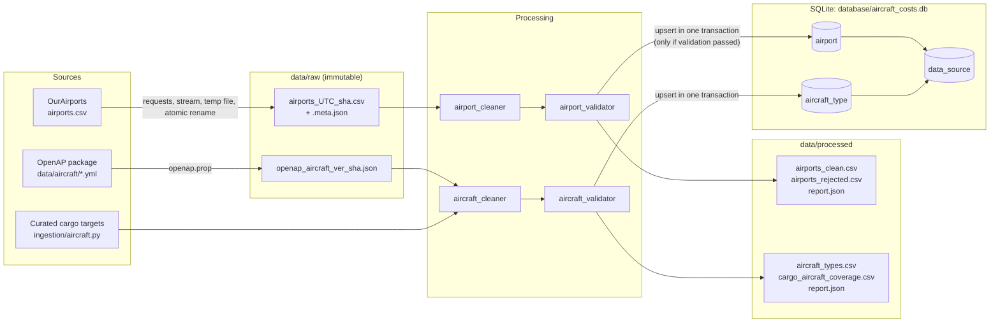
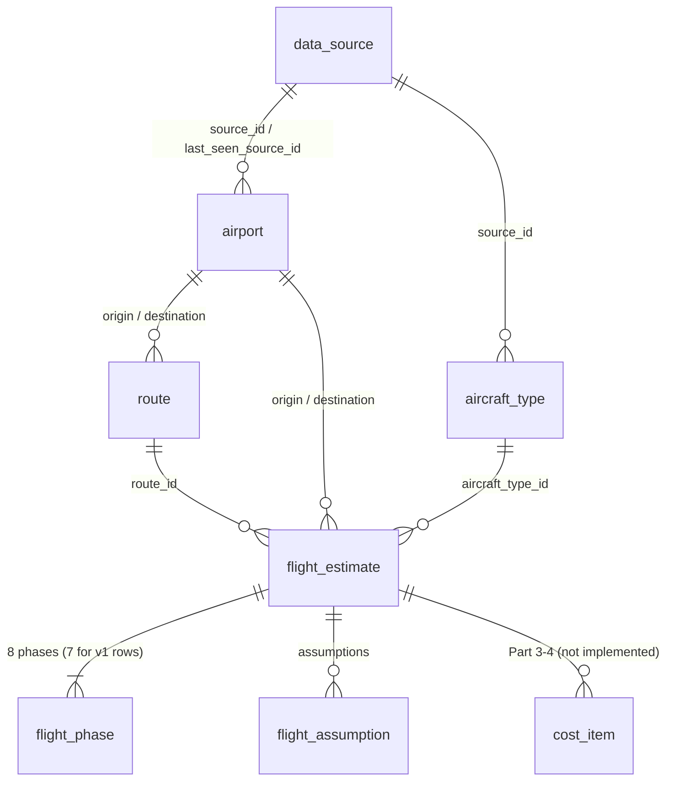

# Architecture (Parts 1–2: data foundation and flight performance)

## Components

| Module | Responsibility |
|---|---|
| `config.py` | Project root detection, paths, dataset URLs, timeouts, `.env` overrides, directory creation |
| `logging_config.py` | Structured `event key=value` logging in UTC |
| `ingestion/airports.py` | Streams the OurAirports CSV to a temporary file, computes SHA-256, renames atomically, writes a metadata sidecar, deduplicates identical snapshots |
| `ingestion/aircraft.py` | Reads aircraft records from the installed OpenAP package (no synonyms), snapshots them, and defines the curated cargo targets |
| `processing/airport_cleaner.py` | Column mapping, whitespace and case normalization, type coercion, rejection of unusable rows with a reason |
| `processing/aircraft_cleaner.py` | Converts OpenAP records into master rows with per-field provenance; builds freighter coverage rows |
| `validation/*` | Checks cleaned data and produces `ValidationReport` (blocking errors and non-blocking warnings) |
| `models/*` | SQLAlchemy ORM tables `data_source`, `airport` and `aircraft_type` (`models/base.py` holds the shared declarative base) |
| `database.py` | Engine (foreign keys on), schema creation, transactional upserts |
| `migrations/` (Alembic) | Versioned schema: `0001_part1_baseline`, `0002_part2_flight_performance`, `0003_touchdown_fuel_boundaries` |
| `performance/*` | Part 2: airport lookup, route distance, OpenAP adapter, kinematic profile, mass checks, fuel integration, iterative planning, persistence (see [flight_performance.md](flight_performance.md)) |
| `data/reference/*.csv` | Version-controlled curated inputs: freighter targets, manufacturer document references |
| `scripts/*` | Command-line orchestration and summaries (`ingest_*`, `verify_database`, `calculate_flight`) |

## Data flow

1. **Download.** The file is streamed to `.airports_<UTC>.csv.part` while its SHA-256
   is computed. A non-200 status, network error, empty body or truncation
   removes the temporary file and raises `DownloadError`. On success it is
   renamed to `airports_<UTC>_<sha12>.csv` and a `.meta.json` sidecar is written
   (source URL, final URL after redirects, timestamp, checksum, size, ETag,
   Last-Modified). If the content matches the newest snapshot, the duplicate is
   discarded and the existing snapshot is reused.
2. **Clean.** All fields are read as text with NA inference disabled (`NA` is
   the North America continent code and the Namibia country code). Fields are
   stripped, codes uppercased, coordinates and elevation coerced to numbers,
   and `scheduled_service` mapped to a nullable Boolean. Unusable rows go to a
   rejected file with a reason, and the first occurrence of a duplicate id is
   kept. All airport types are preserved, including heliports and closed
   airports.
3. **Validate.** The validator re-checks invariants (unique ids, coordinate
   ranges, numeric types, non-empty identifiers) and records missing values,
   counts by country and type, and warnings. Data is loaded only if there are
   no blocking errors.
4. **Load.** One transaction registers the `data_source` row (keyed by dataset
   name and checksum) and upserts records on stable keys (`source_airport_id`,
   `aircraft_code`) using SQLite `INSERT ... ON CONFLICT DO UPDATE ... WHERE <values differ>`.
   Unchanged rows are not rewritten, so `updated_at` reflects real changes. Any
   failure rolls back everything, including the source row.

## Why raw data is preserved

The raw download is the evidence for every number in the database. Keeping it
byte for byte, with its checksum and retrieval time, makes it possible to:

- reproduce or audit any cleaned output;
- re-clean old versions after fixing a cleaning bug;
- tell which upstream version a record came from (OurAirports changes nightly).

Raw files are never edited. Each new version is a new file.

## Why cleaning and validation are separate

The cleaner *transforms* data and decides which rows cannot be used at all.
The validator *checks* the result independently and decides whether the dataset
may be loaded. Keeping them separate:

- makes each one testable on its own;
- means a bug in the cleaner shows up in the validator instead of slipping through;
- lets the validator also run against data from other cleaners or sources later.

Missing optional fields are warnings, never grounds to reject a dataset.

## Schema migrations

The schema is managed with Alembic. Migrations live in the package
(`src/aircraft_cost_model/migrations`), so they work after installation and
from any working directory.

- `database.migrate_database(url)` runs at the start of every script.
  - An empty database gets all migrations.
  - A versioned database gets any pending migrations.
  - An **unversioned** Part 1 database is first compared with the schema the
    baseline migration would create: columns, types, nullability, indexes and
    unique and foreign keys. Only an exact match is *stamped* at
    `0001_part1_baseline` and then upgraded. A mismatch raises
    `SchemaVerificationError` and leaves the database untouched.
- Migrations are additive. `0002` adds columns with `ALTER TABLE … ADD COLUMN`
  and back-fills them from existing data; Part 1 tables are never recreated.
- The CLI equivalent is `alembic upgrade head`, run from the repository root.
- Tests check that the ORM models and the migrated schema match exactly
  (`alembic.autogenerate.compare_metadata`), and that the
  downgrade/upgrade round trip preserves Part 1 data.

On 2026-10-15 the live database was backed up to
`database/aircraft_costs.pre-part2-<UTC>.db` (git-ignored), verified, stamped
and upgraded. Its 86,251 airports, 42 aircraft types and data sources were
preserved.

## Why SQLite

- It needs no server: one file, part of the Python standard library, and works
  the same on macOS, Linux and Windows.
- It handles the current volumes easily (~86k airports, ~40 aircraft types).
- It enforces relational integrity (foreign keys, unique constraints) and
  supports transactions and `ON CONFLICT` upserts.
- SQLAlchemy keeps the code portable. Moving to PostgreSQL later mostly means
  replacing the SQLite-specific upsert (`sqlalchemy.dialects.sqlite.insert`)
  with the PostgreSQL equivalent.

All schema changes go through Alembic migrations (see above).

## How the tables connect

- `route` stores only stable airport-pair facts: the great-circle distance and
  its method. Scenario-specific route factors and distances belong to
  `flight_estimate`.
- `flight_estimate` stores inputs, results, the model name and version, the
  exact OpenAP model code and engine, the loading checks (JSON), warnings, a
  hash of the inputs and the path of the trajectory CSV. Per-time-step states
  are written to `data/processed/flights/flight_estimate_<id>_<hash>.csv`
  rather than the database.
- Part 3 cost tables will reference `flight_estimate`, using block time, block
  and trip fuel, distances and take-off and landing mass. Each cost table will
  also reference `data_source` for tariffs and benchmarks.

## Part 2 data flow

See [flight_performance.md](flight_performance.md) for the full pipeline
diagram, equations and limitations.
