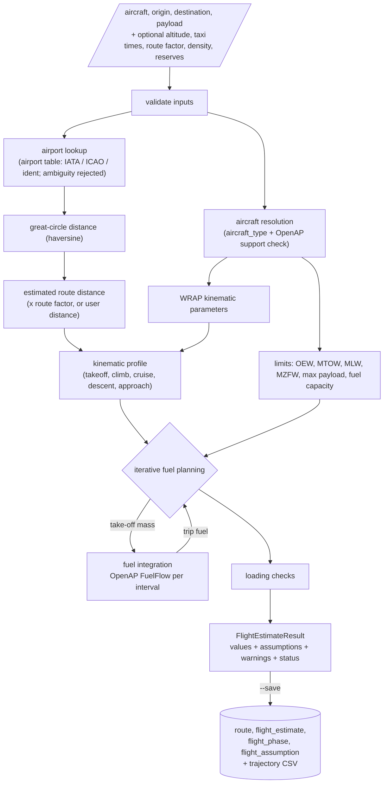

# Flight performance model (Part 2)

This model estimates route distance, flight and block time, and fuel burn for
one flight. Its outputs are **model estimates for cost analysis. They are not
dispatch fuel plans and must not be used for flight-safety decisions.**

All numbers below come from OpenAP **2.6.2**, the version inspected and
pinned in `pyproject.toml`.

## 1. Pipeline



Code layout (`src/aircraft_cost_model/performance/`):

| Concern | Modules |
|---|---|
| Pure calculations | `route.py`, `profile.py`, `mass.py`, `fuel.py`, `units.py` |
| OpenAP integration | `openap_adapter.py` (performance models), `atmosphere.py` (ISA conversions) |
| Database access | `airport_lookup.py`, `persistence.py` |
| Orchestration | `planner.py` |
| Errors | `exceptions.py` |

## 2. From airport coordinates to route distance

**Airport lookup** (`airport_lookup.get_airport`):
- The input is uppercased and matched against `iata_code`, `icao_code` (the
  source's dedicated ICAO column) and `airport_ident`. `gps_code` is never
  used.
- If the code matches more than one airport, the lookup is rejected. The live
  data has 76 such codes, for example `AGI`. Use `iata:`, `icao:` or `ident:`
  to choose one.
- Coordinates must be finite and within range.

**Great-circle distance** (haversine, spherical Earth, R = 6371.0088 km, the
IUGG mean radius):

```
a = sin²(Δφ/2) + cos φ1 · cos φ2 · sin²(Δλ/2)
d = 2R · atan2(√a, √(1−a))            [km]
d_NM = d_km / 1.852                    (1 NM = 1.852 km exactly)
```

Longitude differences enter only through `sin²(Δλ/2)`, so routes across the
International Date Line take the short way round. A spherical Earth differs
from the WGS84 ellipsoid by up to about 0.5 %.

**Why great-circle distance differs from the route actually flown.** Aircraft
follow airways, SIDs and STARs; avoid restricted airspace and weather; follow
ATC vectors and holding; and choose wind-optimal tracks. All of these make the
flown distance longer than the great circle, typically by a few per cent and
by more in congested airspace. This model does not reconstruct flown routes.
It uses:

```
estimated_route_nm = great_circle_nm × route_factor      (default factor 1.0)
```

or a user-supplied distance, which must not be shorter than the great circle.
The method and factor are stored with every estimate. With the default factor
of 1.0 the result is labelled as a great-circle-based estimate.

## 3. OpenAP integration

`OpenAPPerformanceProvider` is the only module that calls OpenAP's
performance classes:

| OpenAP component | Used for | Unit handling |
|---|---|---|
| `prop.aircraft(code, use_synonym=False)` | ceiling, engine default and count, cross-check of DB limits | weights kg, `mfc` litres, ceiling m |
| `kinematic.WRAP(code, use_synonym=False)` | climb, cruise, descent and approach speeds and rates | m/s, km, m/s² |
| `FuelFlow(code, use_synonym=False).enroute(mass, tas, alt, vs, acc)` | airborne fuel flow | kg, kt, ft, ft/min, m/s² → **kg/s** |
| `FuelFlow.takeoff(tas, alt, throttle=1)` | take-off roll | kt, ft → kg/s |
| `data/engine/engines.csv` `ff_idl` | taxi and landing-roll fuel flow | kg/s per engine (ICAO Engine Emissions Databank, idle = 7 % rated thrust) |

**Synonyms are never used.** OpenAP's `WRAP` defaults to `use_synonym=True`,
which would silently give an A21N the A320's kinematics. A type counts as
*supported* only when all four of these exist for that exact code: the
aircraft file, the WRAP model, the drag polar and the default engine record.

The provider records the exact model chain for each estimate:
- aircraft file and engine,
- WRAP model and drag polar,
- whether the fuel-flow coefficients are type-specific (14 types in
  `fuel_models.csv`) or OpenAP's default curve scaled by the engine's ICAO
  take-off fuel flow,
- the OpenAP version.

## 4. Flight phases and the kinematic profile

| # | Phase | Content |
|---|---|---|
| 1 | `taxi_out` | Ground idle for the taxi-out time; no profile states |
| 2 | `takeoff` | Take-off roll (constant acceleration to WRAP lift-off speed) + initial climb to 1,500 ft above the airport |
| 3 | `climb` | WRAP mean vertical rates in three bands: pre-constant-CAS, constant-CAS (below crossover) and constant-Mach |
| 4 | `cruise` | Level flight at the cruise altitude and schedule TAS for the remaining distance |
| 5 | `descent` | WRAP mean rates in three bands: constant-Mach, constant-CAS and post-CAS, down to 1,000 ft above the destination |
| 6 | `approach` | Final approach at WRAP approach CAS and rate to **touchdown** |
| 7 | `landing_roll` | Touchdown to rest at WRAP braking deceleration, ground idle (no reverse thrust) |
| 8 | `taxi_in` | Ground idle for the taxi-in time |

Phases 2–6 form the **trip** (brake release → touchdown). Before migration
0003 the landing roll was part of `approach_landing`; see §5.

Construction (`profile.generate_profile`):
- **Intervals.** Within each interval vertical speed is constant and TAS
  changes linearly. Altitude is exact; distance is `(v0 + v1)/2 · dt`.
- **Exact boundaries.** Intervals are at most `time_step_s` long (default
  30 s) and are shortened so that every boundary is reached exactly. A
  boundary is a target altitude, a target speed, a phase change or the route
  end.
- **Speeds.** Climb follows the CAS/Mach schedule
  `TAS = min(cas2tas(CAS, h), mach2tas(M, h))` (ISA). It accelerates at
  0.5 m/s² until it reaches the schedule. Below the constant-CAS band, descent
  decelerates at 0.2 m/s² to the approach speed. Both constants come from
  OpenAP's `FlightGenerator`.
- **Distance fitting.** Climb and descent are generated first. Cruise covers
  `route − climb − descent`, so the sum of phase distances equals the route
  distance.
- **Short routes.** If climb plus descent exceed the route, the cruise
  altitude is lowered in 1,000 ft steps, with a warning. The floor is
  1,500 ft above the origin and 1,000 ft above the destination. Below that,
  `RouteTooShortError` is raised. FRA–CDG (242 NM) cruises at 33,000 ft
  instead of 36,000 ft; FRA–HHN (50 NM) cruises at 9,000 ft.
- **Wind.** None, so ground speed equals TAS. Actual winds can change flight
  time and fuel burn materially (headwinds on westbound transatlantic flights
  add tens of minutes). Weather is a later enhancement.

**Simplifications:**
- Kinematics use WRAP *typical* (mean) values and do not depend on mass.
- ISA atmosphere.
- Clean-configuration drag throughout the airborne phases; flap and gear drag
  are not modelled.
- Small speed jumps at phase boundaries where WRAP parameters differ (for
  example cruise Mach 0.78 versus descent Mach 0.77).

## 5. Fuel flow and why it is integrated over time

Fuel flow is a rate (kg/s). It depends on mass, speed, altitude and vertical
speed, all of which change during the flight. Total fuel is therefore the
time integral `∫ ff(t) dt`; multiplying one representative rate by the flight
time would ignore climb, descent and the steady loss of mass.

For each interval (explicit midpoint, RK2, in mass):

```
ff1   = ff(state_mid, m_start)           state_mid: mid-interval altitude and TAS, interval vs and acceleration
m_mid = m_start − ff1 · dt/2
ff2   = ff(state_mid, m_mid)
burn  = ff2 · dt                         [kg/s × s = kg]
m_end = m_start − burn
```

Fuel-flow method by mode:
- **Take-off roll:** `FuelFlow.takeoff` at full rated thrust, with no derate.
- **Airborne:** `FuelFlow.enroute`, where thrust = drag + m·g·sin γ + m·a.
  During descent, OpenAP floors thrust at its minimum (about idle).
- **Landing roll and taxi:** ICAO idle fuel flow × number of engines. Reverse
  thrust and single-engine taxi are not modelled.

Every fuel-flow value is checked. A negative, NaN or infinite result raises
`FuelFlowError`, and so does a mass that becomes non-positive. Mass therefore
decreases monotonically.

Accuracy: for `ff = c·m` the integrator matches the analytic
`m0·(1 − e^(−cT))` to within 1e-6 relative (tested). For A320 FRA–CDG, trip
fuel is 1,937.6 kg with 30 s steps and 1,937.2 kg with 5 s steps (0.02 %).

**Mass and fuel boundaries (`fuel_accounting_basis = v2`; no double counting):**

```
Take-off mass       = mass at brake release (start of the take-off roll)
Landing mass        = mass at touchdown                    (MLW is checked here)
Trip fuel           = takeoff + climb + cruise + descent + approach
                    = fuel burned brake release → touchdown
                    = take-off mass − landing mass           (exact; regression-tested)
Landing-roll fuel   = touchdown → rest (ground idle)
Taxi fuel           = taxi-out + taxi-in
Block fuel          = taxi-out + trip + landing roll + taxi-in
Fuel per NM         = trip fuel / estimated route distance   [kg/NM]
Fuel per block hour = block fuel / (block time / 60)         [kg/h]
```

"Trip fuel" includes the take-off roll, which happens on the ground. This
follows the convention that take-off mass is measured at brake release. The
estimated route distance spans brake release to the end of the landing roll.
Fuel per NM therefore divides trip fuel (which stops at touchdown) by a
distance that also includes the landing-roll ground distance: about 1.07 NM
for the A320, 69.4²/(2 × 1.22) m. This is under 1 % of distance for routes
longer than about 110 NM.

*Correction made at Part 2 review (2026-10-15).* The first implementation ran
both trip fuel and landing mass to the **end of the landing roll**. The two
still reconciled with each other, but landing mass was not the touchdown mass,
the MLW check was about 12 kg non-conservative for an A320, and "trip fuel"
included runway fuel. Estimates saved under that definition are labelled
`fuel_accounting_basis = v1` and were kept unchanged.

## 6. Aircraft mass and iterative fuel planning

```
ZFW            = OEW + payload
planned fuel   = taxi-out + trip + landing roll + taxi-in + contingency% × trip + alternate + final reserve
ramp mass      = ZFW + planned fuel
take-off mass  = ramp mass − taxi-out fuel                (brake release)
landing mass   = take-off mass − trip fuel                (touchdown)
block-in mass  = landing mass − landing-roll fuel − taxi-in fuel = ZFW + reserves
```

Trip fuel depends on take-off mass, which depends on trip fuel. The planner
iterates:

1. `T0` = trip fuel integrated at the lightest possible take-off mass,
   `ZFW + landing roll + taxi-in + fixed reserves` (no trip fuel on board).
   Landing-roll fuel is mass-independent (ground idle), so it is known in
   advance. This is a lower
   bound, so no arbitrary first guess is needed.
2. `TOW_k = ZFW + planned(T_k) − taxi-out`; integrate to get `T_(k+1)`.
3. Stop when `|T_(k+1) − T_k| ≤ tolerance` (default 1 kg). Raise
   `ConvergenceError` after `max_iterations` (default 25) with the full
   history.

Iterates increase monotonically. A320 FRA–CDG converges in 2 iterations
(1,909.9 → 1,937.3 → 1,937.6 kg) and A330-200 FRA–JFK in 6.

Contingency, alternate and final reserve are **user-supplied quantities**,
defaulting to 0 with a warning. No regulatory fuel policy is implemented.

**Loading checks:**

| Check | Basis |
|---|---|
| payload ≥ 0, fuel ≥ 0 | inputs |
| payload ≤ max payload | not performed: no free source |
| ZFW ≤ MZFW | not performed: no free source |
| ramp ≤ maximum ramp weight | not performed: not in master data |
| take-off mass ≤ MTOW | OpenAP MTOW |
| landing mass ≤ MLW | OpenAP MLW |
| planned fuel ≤ capacity | OpenAP `mfc` (L) × fuel density |
| mass decreases with burn | trajectory |

Status values:
- `infeasible`: any check failed. The CLI exits with code 2 and nothing is
  saved.
- `calculated_limits_unverified`: any check not performed. Currently this
  applies to every OpenAP aircraft, because MZFW and maximum payload are
  unavailable.
- `calculated`: all checks performed and passed.

Performance-limited take-off and landing weights (runway, climb gradient,
temperature) are not modelled.

## 7. Flight time and block time

| Quantity | Definition |
|---|---|
| Airborne time | lift-off → touchdown |
| Trip time | brake release → touchdown = take-off roll + airborne |
| Landing roll | touchdown → rest |
| Block time | taxi-out + trip time + landing roll + taxi-in |

All three reconcile exactly. Phase durations sum to block time and are tested.

## 8. Aircraft coverage (OpenAP 2.6.2, no synonyms)

**Supported (16):** A319, A320, A321, A332, A333, A343, A388, B737, B738,
B739, B744, B752, B77W, B788, B789, E190.

- Type-specific fuel coefficients: A319, A320, A321, A332, A333, B737, B738,
  B739, E190.
- OpenAP default curve scaled by the engine's ICAO take-off fuel flow: A343,
  A388, B744, B752, B77W, B788, B789.

**OpenAP types that are not supported (21):**
- Missing WRAP kinematics: A19N, A20N, A21N, A318, A359, B37M, B38M, B39M,
  B3XM, B734, B748, B772, B773, C550, CRJ9, E145, E170, E195, E75L, GLF6.
- Missing drag polar: B763.
- Missing engine-databank record: A318 and the 737 MAX family (in addition
  to their missing WRAP models).

**Target freighters: all unsupported, with an explicit error:**

| Freighter | Code | Status | Reason |
|---|---|---|---|
| Airbus A330-200F | A330-200F | unsupported | OpenAP A332 is the passenger A330-200; not substituted |
| Boeing 777F | B777F | unsupported | no OpenAP model for B77L (synonym → B77W ignored) |
| Boeing 767-300F | B767-300F | unsupported | B763 passenger model also lacks a drag polar |
| Boeing 747-400F | B747-400F | unsupported | OpenAP B744 is the passenger 747-400; not substituted |
| Airbus A321P2F | A321P2F | unsupported | OpenAP A321 is the passenger A321; conversion changes OEW and limits |

Manufacturer freighter specifications exist (see
[data_sources.md](data_sources.md)), but their terms do not permit reuse
without permission, so no values were extracted.

**End-to-end validation used the A320, a passenger aircraft directly
supported by OpenAP. It is not a cargo-aircraft performance result.**

## 9. Example (live database, 2026-10-15)

`python scripts/calculate_flight.py --aircraft A320 --origin FRA --destination CDG --payload-kg 10000 --save`

| Quantity | Value |
|---|---|
| Great-circle / estimated route distance | 241.8 NM (447.8 km) / 241.8 NM (factor 1.0) |
| Cruise altitude | 33,000 ft (lowered from 36,000 ft: route too short) |
| Climb / cruise / descent | 18.6 / 1.4 / 22.1 min |
| Airborne / trip / landing roll / block time | 44.2 / 44.9 / 0.9 / 71.9 min (taxi 13 + 13 min, labelled default assumptions) |
| ZFW / take-off (brake release) / landing (touchdown) mass | 52,600 / 54,704 / 52,779 kg |
| Trip / landing roll / taxi / block fuel | 1,925 / 12.2 / 334 / 2,271 kg |
| Take-off − landing mass | 1,925 kg = trip fuel |
| Fuel per NM / per block hour | 7.96 kg/NM / 1,897 kg/h |
| Status | `calculated_limits_unverified` (MZFW, max payload, MRW unavailable) |

## 10. Limitations

- No wind or temperature deviation. Mean WRAP kinematics, independent of mass.
- Clean-configuration drag during approach. No reverse thrust. No
  single-engine taxi. No derated take-off.
- OpenAP fuel-flow models have documented uncertainty, especially for types
  using the default curve.
- Default taxi times are not airport-specific: the ICAO LTO 26 min total is
  split equally.
- Type-level OpenAP OEW and limits are not operator- or
  weight-variant-specific.
- No regulatory fuel policy, alternate selection or step climbs.
- The model is not suitable for dispatch, flight planning or safety
  decisions.
